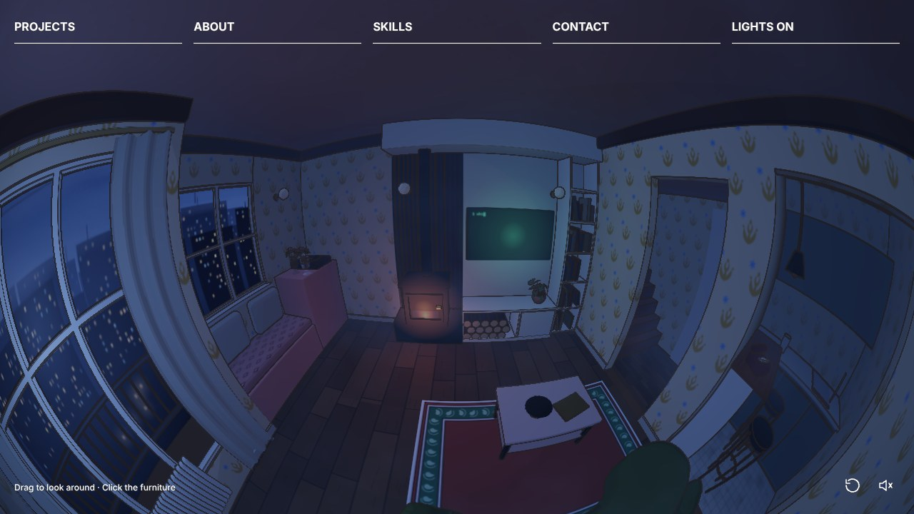

<div align="center">

# Jiwoo's Room

**A little 360° room you can look around in. My portfolio.**

[**Open it → 8jiwoo.github.io**](https://8jiwoo.github.io)

<a href="https://8jiwoo.github.io"></a>

</div>

## Look around

You're standing in the middle of a small flat just before sunrise. Drag to look around, scroll or pinch to zoom, and click things in the room:

| Click | Opens |
| --- | --- |
| 📺 The TV | **Projects** |
| 🗄️ The pink cabinet | **About** |
| 📚 The bookshelf | **Skills** |
| ☎️ The red phone | **Contact** |
| 💡 Any light | Lights on / off |

The menu along the top does the same thing. Turn the sound on (bottom right) for a quiet, rainy-morning soundtrack.

## How it's made

- **[three.js](https://threejs.org)**: the whole room is built in code, in a single `index.html`
- **Fisheye lens**: the room is rendered into a 360° cube map, then bent through a custom shader
- **Cartoon look**: flat cel shading plus hand-drawn-style ink outlines worked out from surface edges
- **Small touches**: drifting fog, swaying curtains, a clock showing the real time, and a terminal that types itself

No build step and no framework. Just open `index.html` from a local server.

```bash
python3 -m http.server
# then visit http://localhost:8000
```

## Credits

3D models from the [Khronos glTF Sample Assets](https://github.com/KhronosGroup/glTF-Sample-Assets):

- **Glam Velvet Sofa**: Eric Chadwick, © 2021 Wayfair, LLC ([CC BY 4.0](https://creativecommons.org/licenses/by/4.0/))
- **Diffuse Transmission Plant**: Eric Chadwick, © 2024 Darmstadt Graphics Group GmbH ([CC BY 4.0](https://creativecommons.org/licenses/by/4.0/)), based on an original by Rico Cilliers ([CC0](https://creativecommons.org/publicdomain/zero/1.0/))
- **Glass Vase with Flowers**: Eric Chadwick and Rico Cilliers ([CC0](https://creativecommons.org/publicdomain/zero/1.0/))

Night environment light from the [three.js examples](https://github.com/mrdoob/three.js/tree/dev/examples/textures). Menu layout inspired by [Balming Tiger](https://balmingtiger.com).

---

<div align="center">

[LinkedIn](https://www.linkedin.com/in/jiwoohahaha) · [GitHub](https://github.com/8jiwoo)

</div>
